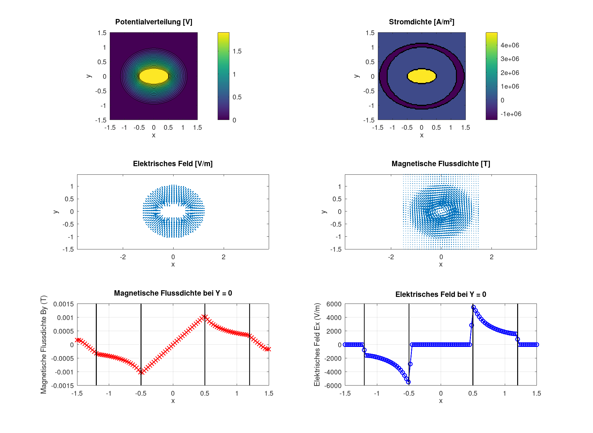

# Coaxial Cable Simulation with the Finite Difference Method



This project models the cross-section of a coaxial cable with the finite difference method (FDM). It solves for the electric potential and magnetic vector potential, derives the electric field and magnetic flux density, and estimates the capacitance per unit length, inductance per unit length, and characteristic impedance.

The model uses elliptical inner and outer conductors and a homogeneous dielectric. It also calculates reference values using the standard analytical formulas for a circular coaxial cable.

## Requirements

- MATLAB or GNU Octave
- `gmres` (included with MATLAB and GNU Octave)

No additional packages are required.

## Run

From this directory, run the script in MATLAB:

```matlab
coax_fdm
```

Or run it in GNU Octave:

```sh
octave coax_fdm.m
```

The script prints the simulated and analytical capacitance, inductance, and impedance to the console. It also opens figures for the mesh and conductor geometry, potential, current density, electric and magnetic fields, and field profiles along the horizontal centerline.

## Model Parameters

The main parameters are defined near the beginning of `coax_fdm.m`:

- Grid: `101 x 101` points over a `3 mm x 3 mm` domain
- Inner conductor semi-axes: `0.5 mm` and `0.25 mm`
- Outer conductor semi-axes: `1.2 mm` and `1.0 mm`
- Relative permittivity: `2.3`
- Inner-conductor voltage: `2 V`
- Conductor current: `2 A`

Edit these values to explore other cross-sections and excitations. The geometry offset is controlled by `x_offset`.

## Notes

This is a two-dimensional, static field model. It does not include frequency-dependent skin effect, dielectric or conductor losses, or propagation effects. The analytical reference formulas assume circular conductors, so they are only a rough comparison for the elliptical geometry used by the numerical model.

The MATLAB script was transcribed and normalized from the code appendix in `Nils_Hepp.pdf`.